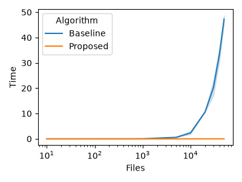
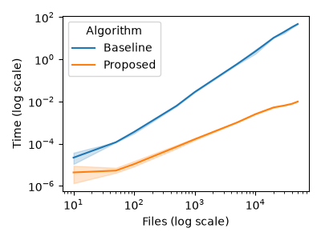

# Empirical Evaluation

## Overview
We implemented our two algorithms (`methods.py`) that solve the Server Migration problem:
1.  **Baseline Algorithm:** A naive greedy approach that repeatedly finds the maximum element in the array and scans the remainder of the array for its best pair. 
2.  **Proposed Algorithm:** An optimized greedy approach that sorts the array first, then uses a left and right pointer to pair the smallest and largest available files in a single pass.

Unit testing (`test_migration.py`) confirms that both algorithms return the correct minimum server count across multiple typical and edge cases (empty arrays, perfectly matched pairs, and unpairable elements).

## Benchmarking Results
We compare the performance of our two algorithms on randomly generated arrays with $L=100$ (`benchmark.py`), varying input size ($n$) from 10 to 50,000 files. We present the results in the plots below. The left plot shows the execution time on a linear scale, while the right plot uses a logarithmic scale for both axes.

|  |  |
|---|---|

The empirical data aligns with our theoretical complexity analysis (`planning.md`):

*   **Baseline Quadratic Scaling:** The baseline algorithm theoretically scales at $\mathcal{O}(n^2)$ due to repeatedly scanning the remaining list for the largest element.
*   **Proposed Algorithm Efficiency:** The proposed algorithm scales at $\mathcal{O}(n \log n)$, constrained almost entirely by Python's built-in sorting algorithm. Sorting the 50,000 elements and performing the $\mathcal{O}(n)$ two-pointer traversal takes just 0.0135 seconds. At $n = 50,000$, the proposed algorithm is several orders of magnitude faster than the baseline. In particular, the proposed algorithm is approximately **2,900 times faster**, illustrating that optimizing data organization (sorting) before processing drastically outperforms naive continuous searching.